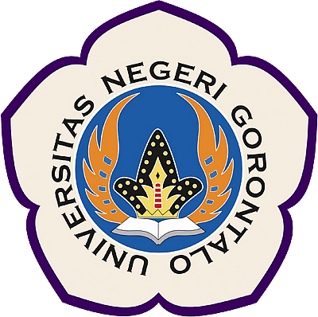

# Scout - Sistem Seleksi & Rekomendasi Seleksi Peserta Kompetisi Mahasiswa

  
  &nbsp;&nbsp;&nbsp;&nbsp;
  

**Scout** adalah platform cerdas yang dirancang untuk membantu mahasiswa menemukan kompetisi yang paling sesuai dengan profil, minat, dan keterampilan mereka. Aplikasi ini memanfaatkan teknologi **Retrieval-Augmented Generation (RAG)** dan **Large Language Models (LLM)** untuk memberikan rekomendasi yang presisi dan personal.

Selain rekomendasi, Scout juga menyediakan fitur Chatbot (Advisor) yang dapat menjawab pertanyaan mahasiswa seputar kompetisi, strategi pemenangan, dan persiapan administratif secara real-time.

**🔗 Live Demo:** [https://thesis.fzrsahi.com/](https://thesis.fzrsahi.com/)

---

## 🚀 Fitur Unggulan

### 1. 🔍 RAG-Powered Recommendation
Menggunakan **PostgreSQL dengan ekstensi `pgvector`** untuk menyimpan dan mencocokkan vektor embedding dari dokumen PDF lomba dengan profil mahasiswa. Sistem ini tidak hanya mencocokkan kata kunci, tetapi memahami *konteks* persyaratan lomba.

### 2. 🤖 AI Chat Advisor
Asisten virtual cerdas yang ditenagai oleh **GPT-4o** (via OpenAI/Azure) atau **Gemini**. Mahasiswa dapat berkonsultasi tentang:
- Kelayakan mereka mengikuti lomba tertentu.
- Tips menyusun proposal.
- Penjelasan detail mengenai aturan lomba.

### 3. 📄 Manajemen Dokumen Cerdas
Admin dapat mengunggah flyer, buku panduan, atau dokumen lomba dalam format PDF. Sistem secara otomatis akan melakukan:
- **Chunking**: Memecah dokumen menjadi bagian-bagian kecil.
- **Embedding**: Mengubah teks menjadi vektor matematis menggunakan `text-embedding-3-small`.
- **Indexing**: Menyimpan vektor ke database untuk pencarian cepat.

### 4. 📊 Profiling Mahasiswa Komprehensif
Mahasiswa dapat melengkapi data akademik (IPK, Prodi), minat, keterampilan, dan pengalaman organisasi untuk meningkatkan akurasi rekomendasi.

---

## 🛠️ Tech Stack

Aplikasi ini dibangun dengan teknologi web modern untuk menjamin performa, skalabilitas, dan pengalaman pengguna yang premium.

- **Frontend & Framework:** [Next.js 15](https://nextjs.org/) (App Router, Turbopack)
- **Bahasa Pemrograman:** [TypeScript](https://www.typescriptlang.org/)
- **Styling:** Tailwind CSS, Framer Motion (untuk animasi)
- **Database:** PostgreSQL
- **Vector Extension:** `pgvector` (untuk penyimpanan vector embedding)
- **ORM:** Prisma
- **AI & LLM:**
  - LangChain (Orkestrasi AI)
  - OpenAI / Azure OpenAI / Google Gemini (Model LLM)
  - `text-embedding-3-small` (Model Embedding)
- **Authentication:** NextAuth.js (v5 Compatible) / Custom Auth
- **Infrastructure:** Docker (untuk database lokal)

---

## 📋 Prasyarat Sistem

Sebelum menginstal, pastikan komputer Anda memiliki:

- **Node.js**: Versi 18 LTS atau lebih baru.
- **npm** atau **yarn**: Package manager.
- **Docker & Docker Compose**: Untuk menjalankan database PostgreSQL dengan ekstensi `pgvector` secara lokal.
- **Git**: Untuk manajemen kode.

---

## 📂 Dokumentasi Lengkap

Kami telah menyusun dokumentasi teknis yang detail untuk membantu Anda memulai:

1. [**Panduan Instalasi**](./docs/instalasi.md) - Cara install project dari 0 di komputer lokal.
2. [**Konfigurasi API AI**](./docs/konfigurasi-api.md) - Cara mengatur API Key OpenAI/Azure dan manajemen kredit.
3. [**Deployment & Hosting**](./docs/deployment-hosting.md) - Panduan deploy ke server VPS atau cloud.
4. [**Manajemen Token & Biaya**](./docs/manajemen-token.md) - Analisis penggunaan token dan cara perpanjang akun API.
5. [**Panduan Penggunaan**](./docs/penggunaan.md) - Cara admin upload lomba & mahasiswa mengisi profil.

---

## 🤝 Kontribusi

Proyek ini dikembangkan sebagai bagian dari Tugas Akhir/Skripsi. Jika Anda ingin berkontribusi, silakan buat *Pull Request* atau laporkan *Issue* di repository ini.

---

© 2025 Scout Team. Built with ❤️ and Code.
